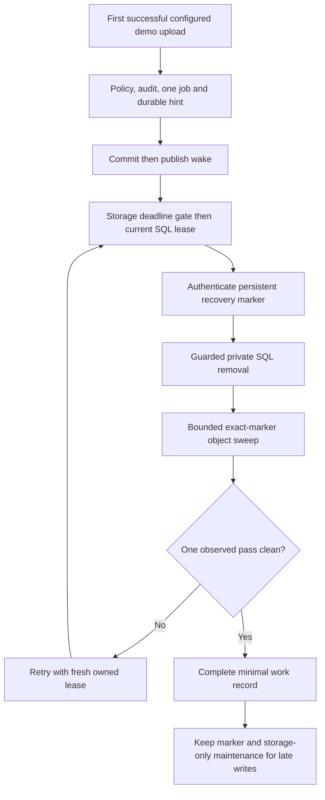

# Enrolled demo purge

Configured demo uploads freeze a [first-upload retention policy](document-retention.md) and prepare one deterministic `Purge` job in the same SQL transaction as the original upload audit. Its canonical payload binds the exact envelope, saved policy digest and deadline. A durable storage hint is written before commit; the queue wake is published afterward. Unknown upload acknowledgement retains the original committed policy/job, and hint recovery can restore a lost wake. Replacement, Send, Finish and completion never restart the interval.

Disabled or missing scheduling prevents new demo enrollment from committing. Ordinary unenrolled uploads remain compatible. Existing enrolled records with a missing job require explicit trusted recovery; GET and replacement do not silently backfill them. New preparation/Send checks the saved job before building a disclosure that says cleanup is queued. Previously frozen disclosures and historical verification remain unchanged.



## Worker behavior

The lazy worker resolves purge SQL/storage/protection only for an actual canonical purge delivery. Empty queues and future storage hints avoid opening SQL; ordinary hint recovery remains key-ring-free. Long configured intervals use bounded queue delays and the existing storage deadline gate, rather than recurring SQL discovery.

The [narrow SQL service](demo-purge-sql.md) requires authenticated marker readback before atomically removing private rows. A lost commit acknowledgement can retry the detached current work through the exact marker. The handler then runs an authenticated bounded pass for that envelope, examining at most 16 object inventory entries. Busy marker leases, protected/changed objects and unfinished inventory remain retryable. A pass has a bounded budget within the current work lease.

Purge transient retries continue beyond the ordinary attempt cap, with backoff and fresh owner/lease checks. The counter saturates without weakening stale-owner checks. Invalid job descriptions remain terminal; verification/dependency failures retain recoverable work rather than inventing authority. Finite email limits and ambiguous-submission protections stay in place.

Work completion means one clean observed inventory pass. The marker **always remains** for later writes and storage recovery. It is not proof that every physical copy, version, backup, provider request or log has been erased. Private SQL removal leaves only the current canonical non-personal work binding and persistent marker state needed by the protocol. Global suppression and unrelated/pre-envelope records stay outside this operation.

Parent locks, FKs and current leases fence old writers from recreating private SQL after removal. Old upload/conversion/storage requests can still finish a blob write afterward, which marker maintenance must re-scan. Legacy decline/verification email now checks enrolled retention under parent-before-work locks and again before submission. An already in-flight provider request or party-held copy cannot be recalled or safely resent merely because its acknowledgement arrives late.

## Explicit recovery and rollout

```text
dotnet QuillSign.dll work resume-demo-purge <32-character-internal-envelope-id>
dotnet QuillSign.dll work purge-recover [1-32]
```

The first command verifies one existing enrolled policy and restores its exact job/hint, without changing its age or enrolling legacy/unproven data. It can explicitly resume a verified formerly exhausted/unsupported purge job while preserving attempt evidence. It does not recreate an absent parent. The second command uses persistent protected markers without SQL and covers late writes, partial inventories and protected-version retries. Both commands keep private data and authority out of output.

Hosted enablement still requires approved migrations, the explicit worker SQL execution grant, correct storage/key-ring access, aligned final-version protection, queue processing and a separately configured storage-only recovery schedule. The existing hourly `work recover` job republishes hints only; its current identity must not silently gain deletion/key-ring access. No hosted permission, Bicep resource, schedule, runtime setting, live email or timestamp service is changed by this code. Keep the hosted retention setting unset until operational validation is complete.

The synthetic disclosure's new version describes verified queued cleanup and possible physical-deletion delays. Its original version remains verifiable byte-for-byte. Neither version is a real-use operator policy or a promise of legal enforceability.

Validation uses genuine local upload enrollment, SQL Server/Azurite queues, current worker permissions, bounded deletion and controlled commit/storage failures. Historical synthetic clocks are seeded before upload; frozen policy/audit evidence is never rewritten to manufacture expiry. Browser validation uses synthetic documents and captured email, with no real agreement or outbound provider.
