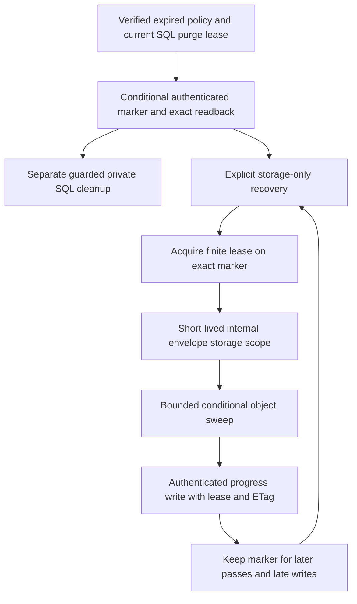

# Storage-only demo purge recovery

This dependency keeps authorized cleanup retryable after private SQL records are removed by the separate [guarded SQL operation](demo-purge-sql.md). It does not itself remove those records, create first-upload purge jobs, run on a timer or enable hosted maintenance. [Fixed retention](document-retention.md) and the [bounded storage capability](demo-purge-storage.md) remain its foundations.

## Durable marker

`DemoPurgeRecovery.RememberAsync` accepts only genuine, unexpired SQL-issued purge storage authority for an already expired enrolled demo policy. It conditionally creates an authenticated marker in the existing configured work-hint container and verifies exact readback before returning. A conflicting marker must match the same opaque envelope ID, policy digest and frozen deadline; a failed or uncertain write cannot invent a new policy or return unverified success.

The dedicated persistent Data Protection purpose is bound to the exact configured hint-container URI. Marker bodies contain only format/version, opaque envelope ID, saved policy digest/deadline and bounded progress; no title, contacts, document bytes, tokens or audit payload. Old keys and the configured application discriminator must remain available. Unknown versions, tampering, cross-container/application/envelope reuse, oversized records and invalid continuation scope fail closed.



Recovery requires no `DbContext`, sender identity or surviving SQL work lease. It reads and authenticates the marker under an exact ETag and a finite 60-second blob lease; the internal storage scope lasts at most 45 seconds and a sweep has a 40-second cancellation budget. Progress writes require that same lease and ETag. Cleanup releases only its owned lease with a bounded token; it never breaks another lease. Lost acquisition responses safely leave a finite lease to expire. Azure's supported finite-lease behavior is documented in [BlobLeaseClient.AcquireAsync](https://learn.microsoft.com/en-us/dotnet/api/azure.storage.blobs.specialized.blobleaseclient.acquireasync).

Each marker pass examines at most 16 inventory entries. Authenticated continuation preserves progress through large prefixes, protected objects and snapshots/versions. An empty or completed inventory pass resets its continuation, **keeps the marker**, and permits later cleanup of a write that arrives afterward. Marker-level leases serialize overlapping maintenance; a separate authenticated conditional batch cursor rotates through marker pages. None of these cursors grants deletion authority, and none is printed.

## Explicit maintenance

```text
dotnet QuillSign.dll work purge-recover [1-32]
```

The default batch examines up to eight markers. It uses configured persistent storage/protection and durable-work readiness, with a 50-second command budget. It registers no SQL context or email/sealing/checkpoint handlers. Ordinary `work recover` remains the existing storage-hint operation and does not resolve a key ring; this separate command intentionally authenticates recovery records with the persistent key ring.

Output contains only operation/status and counts: examined, swept, busy, failed, deleted, protected, changed and pending, plus whether another marker page remains. `More` refers only to the marker-page cursor. `Pending` includes unfinished object inventory or held/changed objects; busy leases and failures retain their markers. Exit success means the bounded command ran without recorded failures, not that all envelope data has been permanently erased. A subsequent explicit batch can continue progress without waking SQL. There is no automatic schedule in this slice.

Legal holds and unexpired object protection are never weakened. Recovery does not promise immediate removal of soft-deleted versions, backups, uncommitted provider blocks or logs. The [coordinator](demo-purge-coordinator.md) requires durable marker readback before private SQL deletion, schedules enrolled records, preserves per-envelope ownership and handles partial/unknown commits. Hosted scheduling, permissions and rollout require operational validation and owner-approved infrastructure.

## Validation boundaries

Synthetic tests use actual local SQL-issued authority, Azurite markers/leases/object deletion and persistent Data Protection keys. They verify recovery after synthetic SQL removal and original lease expiry, new-provider key reuse, tampering/rebinding, bounded object and marker continuation, concurrent maintenance, late writes and uncertain responses. An SDK pipeline fault policy drops acknowledgements only after the real local service has completed the selected operation. The real CLI runs in a separate process with the database connection explicitly empty and no email delivery. Live Azure version-level immutability/RBAC behavior remains separately approved rollout validation.
