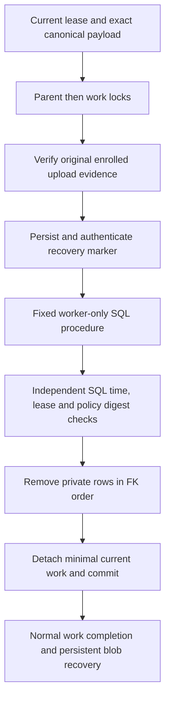

# Expired demo private SQL cleanup

This worker dependency removes one enrolled demo envelope's private SQL records. It does not schedule work, register a purge handler, delete files itself or enable hosted maintenance. [Storage recovery](demo-purge-recovery.md) remains necessary for protected objects and late writes after SQL removal.

`DemoPurgeSql.RemoveAsync` requires a genuine current `Purge` lease and the exact versioned canonical job payload. It owns a transaction, locks the parent before the work row, verifies the original upload policy and audit evidence, and requires authenticated durable marker readback before invoking the fixed SQL procedure. Failure before commit leaves private records intact. A commit acknowledgement can be lost; retry requires the same current lease, canonical detached job and exact authenticated marker, verifies the parent is absent and returns `false` without restoring private rows. A successful new removal returns `true`.



The procedure independently checks server UTC, a demo enrollment, the original upload event, the complete saved policy digest and the exact current lease/payload. Both SQL and application checks reject a future deadline; advancing an application clock cannot erase a live document. Its frozen format reproduces the original ASCII JSON policy digest, including base64 document hashes. Future policy versions require a separately reviewed migration rather than a permissive fallback.

Deletion clears the envelope's current-Finish cycle, then removes owned tokens, fields, completion publication/results/seal/candidate records, Finish/review/adoption/signer records, recipients, other work/outbox, audit, retention and envelope rows. All changes commit together. General suppression, pre-envelope records and unrelated envelopes remain outside the operation. The detached current job retains only its opaque IDs, exact non-personal policy binding and normal lease/work state; the durable marker remains for storage recovery. Neither result means that every physical version, provider-held copy, backup or log is gone.

## Permission preparation

The migration creates `dbo.RemoveExpiredDemoPrivateRecords` with fixed static statements under ordinary caller context. Same-owner SQL ownership chaining permits only those guarded statements to access the protected tables. There is no dynamic SQL, caller-selected object name, impersonation or `EXECUTE AS` context. Existing direct `UPDATE`/`DELETE` denials for immutable evidence stay in place for both the general runtime and worker.

After separately approved migration and worker provisioning, the explicit administrator command is:

```text
dotnet QuillSign.dll database grant-demo-purge
```

This grants only procedure `EXECUTE` through `app_demo_purge_role` to the already provisioned `app_worker`. Ordinary startup, `grant-runtime` and `provision-worker` do not grant it, and the web runtime receives no procedure permission. The command is permission preparation for operator review; it has not been run against hosted SQL. Hosted rollout still requires owner approval. SQL object names here are fixed application aliases, not cloud resource identities.

The SQL module cannot authenticate a blob marker. That requirement belongs to the application protocol before invocation, and authenticated already-removed replay remains private to that protocol. A direct privileged module invocation is not evidence that storage recovery was established. The following coordinator must use this service, handle other workers and ordinary attempt exhaustion, and truthfully update disclosure/readiness before claiming automatic purge.

## Validation

Tests use disposable local SQL databases, actual runtime/worker permissions, genuine first-upload enrollment and Azurite recovery markers. Synthetic historical signing/completion tests use a clock-aware test transport for the legacy raw signer PDF reader; production authorization is unchanged. Faults cover rollback and lost commit acknowledgement. Storage tests independently cover protected versions and late writes. No real agreement, live email/TSA, hosted grant or cloud resource is involved.
